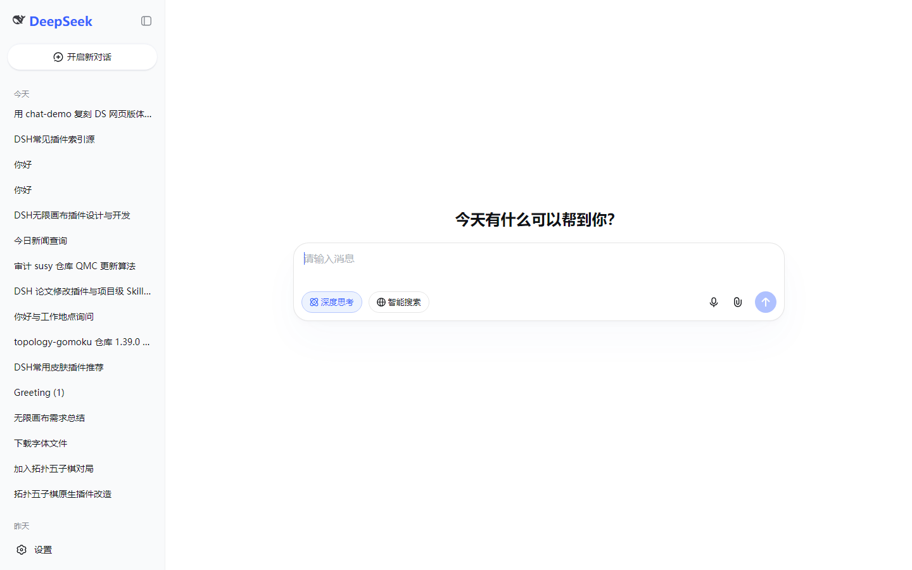

# chat-in-dsh

在 DeepSeek Harness 里加一个「网页版」面板，界面和 chat.deepseek.com 一致，用你在 DSH 里已登录的 DeepSeek，不受官网限额影响。



## 为什么需要它

2026 年 11 月 16 日，DeepSeek App 和网页端开始限额，不少用户因此转到 DeepSeek Harness。他们要的是聊天、写作、问答，而 DSH 默认是给开发者准备的形态：每次对话先塞几千字系统提示词——怎么用工具、怎么改文件、怎么汇报进度——再挂上几十个工具。

模型于是按「干活」的方式说话：句子变短，结论求全，四平八稳，写出来像周报。同一个请求，网页版能给一段有呼吸的散文，这里给的是一篇结构清晰、要点完整的说明文。写作和闲聊时，这个差别最明显。

这个插件在 DSH 里加一个独立面板，面板里就是 DeepSeek 网页版本身：官方那一句系统提示词、官方的服务端工具、官方界面，模型身上没有额外约束。

## 你能得到什么

- **原汁原味**：界面就是 DeepSeek 官方开源的那份前端，交互、排版、动效都没改
- **不用填 API Key**：直接用 DSH 里已经登录的 DeepSeek 账户
- **不受官网限额影响**：请求走 API
- **能力齐全**：智能搜索、深度思考、引用角标、公式、图表、深色模式
- **能从 DSH 带对话过来**：任意会话右键「导入到网页版」，复制一份接着聊


## 安装

把下面这段话直接发给 DSH：

```
帮我安装这个 DSH 插件：https://github.com/YinkaiYu/chat-in-dsh
装好后告诉我怎么打开。
```

安装插件需要写文件权限；如果 DSH 弹出授权请求，点允许。

装完如果左侧面板列表里没有出现「网页版」，重启一次 DSH。

## 使用

点左侧的「网页版」，之后就像用网页版一样聊天。

面板里有自己的会话列表，和 DSH 的会话分开管理。

## 把对话搬进来

**从 DeepSeek 官网搬**

1. 打开 chat.deepseek.com，点「设置 → 数据管理 → 导出所有历史对话」，下载生成的 ZIP（文件名形如 `deepseek_data-2026xxxx.zip`）。
2. 在面板左下角点「设置」→「数据管理」→「导入历史对话」，选中这个 ZIP。

这个入口会覆盖面板里现有的全部对话，建议先把要导入的导完，再开始新的对话。

**从 DSH 搬**

在左侧会话列表里右键任意一条 →「导入到网页版」，那份对话会复制一份进来，之后两边各自独立。

## 关于可靠性

这个插件基于 DeepSeek 官方开源的 [chat-demo](https://github.com/deepseek-ai/chat-demo) 开发。我们对它的改动很少：请求发往哪里、左上角的标识、以及藏起 API Key 输入框。界面、交互、请求逻辑都是官方原版。

没有二次包装，也没有替你"优化"提示词——模型拿到的就是网页上那一份。

