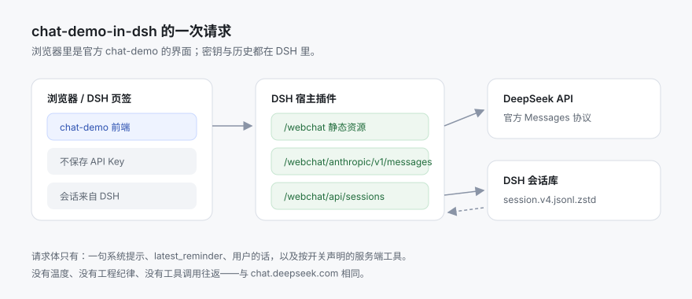

# chat-demo-in-dsh

把 [DeepSeek 官方开源的 chat-demo](https://github.com/deepseek-ai/chat-demo) 搬进 [DeepSeek Harness](https://github.com/deepseek-ai/deepseek-harness)。

安装一个插件，你就在 DSH 里得到 DeepSeek 网页版：**不用装 chat-demo，不用填 API Key，不用导入任何对话**。



## 为什么做这个

2026 年 11 月 16 日，DeepSeek App 与网页端开始限额。随后大量用户转向 DeepSeek Harness。

他们中的许多人并不是开发者：他们要的是一个会聊天的 DeepSeek，而不是一个会改代码、会写文件、每次开口前先读六千字工程规范的智能体。DSH 的默认形态对这些人来说太重了——工具、沙箱、工作目录、审批策略，每一样都在把对话推离"聊天"。

好消息是 DeepSeek 把网页版的前端开源了，也把它的请求形态写进了 API 文档。于是我们做了这个插件：**用官方那一份协议、官方那一套界面，把网页版原样搬进 DSH。**

## 功能

- **与网页版同形态的请求**：系统提示只有一句 `该助手为DeepSeek，由深度求索公司创造。`，每轮附带 `latest_reminder`（日期、星期、地区、平台、语言），工具是服务端的 `deepseek_web_search` / `deepseek_read_url`，没有温度参数，没有工程纪律。
- **中文思考**：和网页版一样，模型用中文推理。你看到的思考面板就是它本来的样子。
- **智能搜索开关**：打开后声明 `deepseek_web_search`，模型自己决定搜不搜，答案带引用；关闭时仍可读链接。
- **完整界面**：Markdown、代码高亮、KaTeX 公式、Mermaid 图、思考折叠、搜索卡片、来源引用、深浅色主题、中英界面。
- **两种打开方式**：DSH 里「插件 → DeepSeek」页签，或直接访问 `http://127.0.0.1:<端口>/webchat/`。
- **对话就是 DSH 的对话**：列表里是你 DSH 的会话，点开即可继续。

## 安装

```bash
dsh plugin --profile desktop add github:YOUR-NAME/chat-demo-in-dsh
```

然后重启 DSH。

## 使用

1. 侧边栏 **插件** → 顶部 **DeepSeek** 页签。
2. 或者在浏览器打开 `http://127.0.0.1:59731/webchat/`（端口以 DSH 实际监听为准）。

不需要登录，不需要粘贴 Key：请求由 DSH 宿主用你已经在 DSH 里登录的 DeepSeek 账户代发。

## 它和 DSH 的模型选择器是什么关系

同一个协议有两个入口，**任选其一即可，不需要都开**：

| 入口 | 用来做什么 |
|---|---|
| 本插件的 **DeepSeek** 页签 / `/webchat/` | 完整网页版界面：搜索卡片、引用角标、Markdown 全套 |
| 模型选择器里的 **DeepSeek 网页版** | 在 DSH 原生聊天界面里发同样的请求；DSH 显示不了搜索卡片，只显示思考与答案 |

两者共用 [packages/chat-demo-in-dsh/src/protocol.js](packages/chat-demo-in-dsh/src/protocol.js) 这一份请求构造，所以不会出现"两个网页版表现不一样"。

## 与官方 chat-demo 的关系

我们 fork 了官方前端，改动集中在数据层与品牌：把 IndexedDB 换成 DSH 会话、把 API Key 换成宿主凭据、把左上角换成 DeepSeek 官方标识。界面组件本身没有动。

- 上游基准：`5d5dd754ebc1948e977ddb880a9eb5aa25f37b4c`（v0.1.1），见 [UPSTREAM.md](UPSTREAM.md)
- 改动补丁：[webview/patches/0001-dsh-integration.patch](webview/patches/0001-dsh-integration.patch)，6 个文件、+49/−215 行
- 已知差异：[FIDELITY.md](FIDELITY.md)（没登记的差异一律算 bug）

上游 MIT，本仓库同样 MIT，保留其版权与许可。

## 开发

```bash
node --test packages/chat-demo-in-dsh/test/protocol.test.js   # 单元测试
pwsh scripts/build-webview.ps1                                  # 重新构建前端并同步产物
```

仓库约定、目录结构、硬约束见 [AGENTS.md](AGENTS.md)。

## 许可

MIT。界面来自 [deepseek-ai/chat-demo](https://github.com/deepseek-ai/chat-demo)（MIT），DeepSeek 与 DeepSeek 标识归深度求索公司所有。
