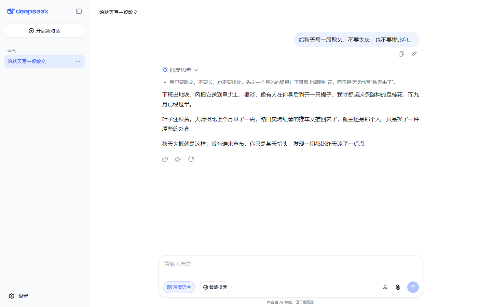

# chat-demo-in-dsh

在 DeepSeek Harness 里加一个独立的「网页版」对话面板：界面和 chat.deepseek.com 一模一样，用的是你自己在 DSH 里登录的 DeepSeek，不受官网限额影响。


## 为什么需要它

同一个模型，在 DSH 里和在网页版里，说话的味道不一样。

DSH 每次对话都要先给模型塞进几千字的系统提示词——怎么用工具、怎么改文件、怎么汇报进度——再挂上几十个工具。模型于是变成了一个「老实人」：话变短，变得周全、安全、像在写周报。写作和闲聊时这个差别最明显：网页版能写出一段有呼吸的散文，DSH 里同样的请求，交上来的常常是「结构清晰、要点完整」的说明文。

不是模型变笨了，是它被要求去当一个干活的助手。

这个插件做的事很简单：**在 DSH 里单开一扇窗，窗那边就是网页版本身**。它拿到的是官方那句话（「该助手为DeepSeek，由深度求索公司创造。」）、官方的服务端工具、官方的那套界面，没有任何多余的约束压在模型身上。

## 你能得到什么

- **原汁原味**：界面就是 DeepSeek 官方开源的那份前端，交互、排版、动效都没改
- **不用填 API Key**：直接用 DSH 里已经登录的 DeepSeek 账户
- **不受官网限额影响**：请求走 API，不吃网页版的额度
- **能力齐全**：智能搜索、深度思考、引用角标、公式、图表、深色模式
- **能从 DSH 带对话过来**：任意会话右键「导入到网页版」，复制一份接着聊



## 安装

不用敲命令。把下面这段话直接发给 DSH：

```
帮我安装这个 DSH 插件：https://github.com/YinkaiYu/chat-demo-in-dsh
装好后告诉我怎么打开。
```

装完重启 DSH，左侧面板列表里会多出一个「网页版」。

## 使用

点左侧的「网页版」，之后就像用网页版一样聊天。

对话存在浏览器本地，换浏览器或清理站点数据会丢；重要的内容记得随手复制走。

想把 DSH 里的对话搬过去：在左侧会话列表里右键任意一条 →「导入到网页版」。这是一次性复制，之后两边互不影响。

## 许可

MIT
